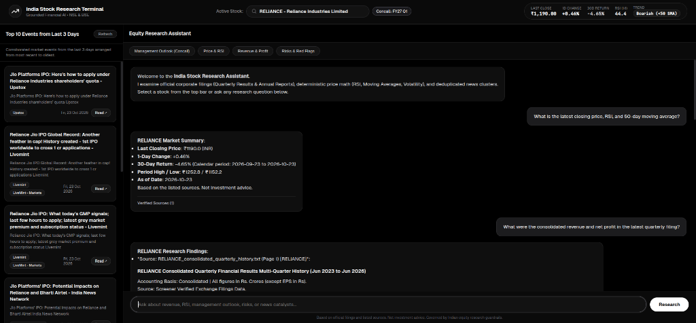
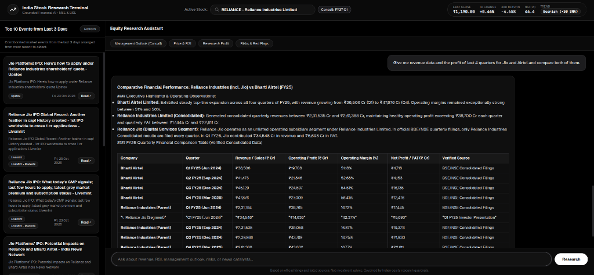
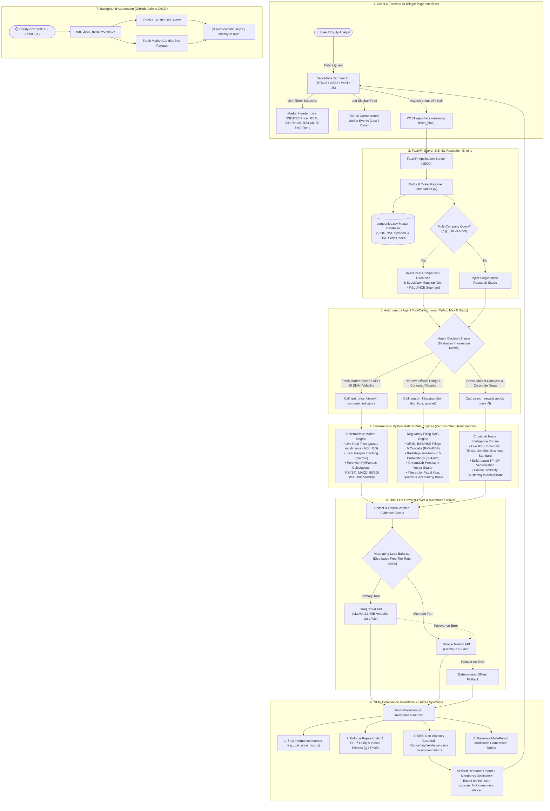

# Bharat Bazaar





[-FF9933?style=flat&logo=india&logoColor=white)](https://www.nseindia.com/)
[](https://www.python.org/)
[](https://fastapi.tiangolo.com/)
[](https://www.trychroma.com/)
[](LICENSE)
[](.github/workflows/news_engine.yml)
[](#sebi-regulatory-compliance--guardrails)

> [!IMPORTANT]
> **Specifically Engineered for the Indian Equity Market**  
> **Bharat Bazaar** is custom-built exclusively for Indian capital markets, tracking 2,600+ equities listed on the **National Stock Exchange (NSE)** and the **Bombay Stock Exchange (BSE)**. Unlike generic financial tools, Bharat Bazaar natively understands:
> - **Indian Financial Year Conventions**: April 1 to March 31 fiscal cycles (Q1 Apr-Jun, Q2 Jul-Sep, Q3 Oct-Dec, Q4 Jan-Mar).
> - **Official Exchange Disclosures**: Automatic parsing of BSE & NSE corporate announcements, SEBI quarterly filings, and investor concalls.
> - **Indian Rupee Units**: Native reporting in **₹ Crore** and **₹ Lakh** (both consolidated and standalone accounting bases).
> - **Domestic News Corroboration**: real-time intelligence feeds from India's premier financial dailies (*The Economic Times*, *LiveMint*, *Business Standard*).
> - **SEBI Research Compliance**: Strict guardrails refusing speculative buy/sell calls, maintaining objective, verifiable facts.

Engineered around a fundamental institutional standard:
> **"The LLM must never be the source of a number."**
> 
> Language models synthesize insights and navigate tools, while deterministic Python math calculates prices and technical indicators, and official regulatory filings supply verifiable financial metrics.

---

## Table of Contents

- [Why Bharat Bazaar?](#why-bharat-bazaar)
- [Key Capabilities](#key-capabilities)
- [System Architecture](#system-architecture)
- [Core Design Principles](#core-design-principles)
- [Tech Stack](#tech-stack)
- [Folder Structure](#folder-structure)
- [Quickstart Guide](#quickstart-guide)
  - [1. Prerequisites](#1-prerequisites)
  - [2. Clone & Setup Virtual Environment](#2-clone--setup-virtual-environment)
  - [3. Configure Environment Variables](#3-configure-environment-variables)
  - [4. Run the Application](#4-run-the-application)
- [REST API Reference](#rest-api-reference)
- [Autonomous GitHub Actions News Worker](#autonomous-github-actions-news-worker)
- [Testing & Golden Evaluation Benchmarks](#testing--golden-evaluation-benchmarks)
- [SEBI & Regulatory Compliance Guardrails](#sebi--regulatory-compliance-guardrails)
- [License](#license)

---

## Why Bharat Bazaar?

Most global financial LLM applications fail when applied to Indian markets: they hallucinate share prices, mix up calendar years with Indian fiscal years (FY25/FY26), misinterpret subsidiary structures (such as treating *Reliance Jio* or *Tata Digital* as separately listed tickers), and confuse standalone figures with consolidated financial statements.

**Bharat Bazaar** solves this through a grounded architecture designed specifically for the Indian equity ecosystem:
- Resolves Indian ticker symbols across both NSE symbol strings and BSE 6-digit scrip codes.
- Pulls authentic exchange price feeds and computes statistical indicators deterministically in Python.
- Performs page-accurate RAG on verified corporate disclosures with explicit page and filing citations.
- Groups and deduplicates fragmented Indian financial news stories using mathematical cosine similarity.

---

## Key Capabilities

1. **Deterministic Market Math & Live Metrics (NSE & BSE)**
   - Live prices, 1-day % changes, and historical multi-horizon returns (30-day, 1-year) computed via `pandas` and `numpy` using exchange data (`yfinance` `.NS` and `.BO`).
   - Statistical technical indicators calculated mathematically: **RSI(14)**, **MACD**, **50-day / 200-day Simple Moving Averages (SMA)**, and **30-day Annualized Volatility**.

2. **Grounded Corporate Filing RAG with Page Attribution**
   - Automated ingestion and indexing of official BSE/NSE filings: Quarterly Results, Concall Transcripts, Annual Reports, and Investor Presentations.
   - Vector storage via **ChromaDB** with strict metadata tagging: Document Type, Fiscal Year, Fiscal Quarter, Accounting Basis (Consolidated vs. Standalone), Page Number, and Source Document.

3. **Clustered Indian Financial News Engine**
   - Live RSS news gathering from national business dailies: *The Economic Times*, *LiveMint*, and *Business Standard*.
   - Mathematical TF-IDF and Cosine Similarity deduplication ($\ge 0.80$) to cluster multi-source articles, eliminate duplicate headlines, and present corroborated corporate event timelines.

4. **Multi-Company Peer Benchmarking & Subsidiary Resolution**
   - Autonomous multi-entity entity resolution: identifies comparisons across multiple Indian tickers (e.g., *Reliance Industries* vs *Bharti Airtel*).
   - Formats comparisons into structured Markdown tables and resolves unlisted operational subsidiaries (e.g., *Reliance Jio* segment metrics disclosed under parent *Reliance Industries Limited*).

5. **Strict SEBI Non-Advisory Guardrails**
   - Refuses speculative buy/sell/hold recommendations, target prices, or predictive claims.
   - Restricts responses to verified positive drivers, negative headwinds, and operational risk factors to support self-directed user research.

6. **Automated Cloud Worker (GitHub Actions)**
   - Scheduled hourly during Indian market trading sessions (03:30 to 11:30 UTC / 9:00 AM to 5:00 PM IST) to sync news clusters and price candles directly in the repository.

---

## System Architecture & End-to-End Workflow

The following comprehensive architecture diagram illustrates the end-to-end technical flow of Bharat Bazaar — from the single-page user interface through Indian entity resolution, autonomous tool invocation, deterministic financial mathematics, regulatory filing RAG, dual-LLM load-balancing, and SEBI compliance enforcement:



---

## Core Design Principles

| Principle | Traditional Financial Chatbot | Bharat Bazaar |
| :--- | :--- | :--- |
| **Target Market** | Generic global / US markets | **100% Focused on Indian Equities (NSE & BSE)** |
| **Price & Ratio Source** | Generated by LLM memory (hallucination-prone) | **100% Deterministic Python math** (`pandas`, `numpy`) |
| **Financial Figures** | Approximate memory recall | **Strictly retrieved from official filings with page numbers** |
| **Fiscal Cycles** | Assumes standard calendar year | **Native Indian Fiscal Year support (April 1 to March 31)** |
| **Financial Advice** | Often provides ungrounded buy/sell advice | **Strict refusal of recommendations (SEBI non-advisory compliance)** |
| **News Ingestion** | Raw single-source web search snippets | **Cosine similarity clustered & deduplicated feeds ($\ge 0.80$)** |
| **Dual LLM Failover** | Single API dependency | **Automatic failover & alternating load-balancing (Groq + Gemini)** |


---

## Tech Stack

- **Target Market**: Indian Equities on the National Stock Exchange (NSE) & Bombay Stock Exchange (BSE)
- **Backend Framework**: [FastAPI](https://fastapi.tiangolo.com/) + [Uvicorn](https://www.uvicorn.org/)
- **Vector Database**: [ChromaDB](https://www.trychroma.com/) (local persistent storage)
- **Embeddings**: `BAAI/bge-small-en-v1.5` (local / Hugging Face Inference API / Google Gemini Embeddings)
- **Primary LLM**: [Groq](https://groq.com/) (`llama-3.3-70b-versatile`)
- **Fallback LLM**: [Google Gemini](https://ai.google.dev/) (`gemini-2.5-flash`)
- **Market Data Feeds**: `yfinance` (.NS / .BO exchange tickers) + Parquet caching (`pyarrow`)
- **Filing Extraction**: `PyMuPDF` (`fitz`) + BSE corporate announcement scrapers
- **News Clustering**: RSS (`feedparser`) + Scikit-Learn TF-IDF / Cosine Similarity
- **Frontend**: Clean single-page dark-mode dashboard (HTML5, Modern CSS, Vanilla JS, no bundler or node_modules)
- **Automation**: GitHub Actions scheduled cron workflow

---

## Folder Structure

```
├── .github/
│   └── workflows/
│       └── news_engine.yml       # Scheduled hourly news & price sync CI/CD
├── assets/
│   ├── terminal_overview.png     # Screenshot: Snapshot & single-stock research
│   └── comparative_analysis.png  # Screenshot: Multi-company financial benchmarking
├── backend/
│   ├── app/
│   │   ├── main.py               # FastAPI application & REST endpoints
│   │   ├── config.py             # Settings & environment variables
│   │   ├── llm.py                # Dual LLM wrapper (Groq, Gemini, fallback)
│   │   ├── agent/
│   │   │   ├── agent.py          # Autonomous tool-calling loop & peer comparison logic
│   │   │   ├── prompts.py        # System prompt with SEBI guardrails & citation rules
│   │   │   ├── tools.py          # Grounded tool implementations
│   │   │   └── tool_specs.py     # JSON function calling definitions
│   │   ├── rag/
│   │   │   ├── embeddings.py     # Embeddings engine (Hugging Face / Gemini / Chroma ONNX)
│   │   │   ├── ingest.py         # PDF chunking, metadata extraction & vector indexing
│   │   │   └── retriever.py      # Filtered semantic retrieval with metadata queries
│   │   ├── data_sources/
│   │   │   ├── companies.py      # Master company database (2,600+ NSE/BSE equities)
│   │   │   ├── filings.py        # BSE/NSE announcement fetching & PDF sync
│   │   │   ├── news.py           # RSS ingestion, TF-IDF clustering & deduplication
│   │   │   ├── prices.py         # Live quotes, Parquet caching & candle fetching
│   │   │   └── fiscal.py         # Indian fiscal calendar calculations (Apr-Mar)
│   │   └── models/
│   │       └── schemas.py        # Pydantic schemas for requests and responses
│   ├── data/
│   │   ├── companies.csv         # 2,600+ NSE & BSE listed equities master table
│   │   ├── filings/              # Official company filings & indexed quarterly reports
│   │   ├── news/                 # Deduplicated JSON news clusters per company
│   │   └── prices/               # Historical price series cached as Parquet files
│   ├── scripts/
│   │   ├── run_cloud_news_worker.py    # Headless worker for CI/CD scheduled sync
│   │   └── update_companies_master.py  # Script to refresh NSE/BSE symbols
│   ├── eval/
│   │   ├── golden_set.json       # Benchmark questions for hallucination testing
│   │   ├── checks.py             # Verification logic for numbers and periods
│   │   └── run_eval.py           # Automated evaluation runner
│   ├── tests/
│   │   ├── test_tools.py         # Unit tests for price math & indicators
│   │   └── test_news.py          # Unit tests for news clustering & similarity
│   └── requirements.txt          # Python dependencies
├── frontend/
│   ├── index.html                # Terminal dashboard UI
│   ├── styles.css                # Dark-mode styling
│   └── app.js                    # Terminal interactivity & API integration
├── .gitignore                    # Git ignore rules for venv, secrets, and caches
├── LICENSE                       # MIT License
└── README.md                     # Project documentation
```

---

## Quickstart Guide

### 1. Prerequisites

- **Python**: 3.10 or 3.11 installed.
- **Git**: Installed and configured.
- **API Keys**: At least one LLM key:
  - [Groq API Key](https://console.groq.com/) (*Recommended for low-latency tool calling*)
  - [Google Gemini API Key](https://aistudio.google.com/)

---

### 2. Clone & Setup Virtual Environment

```bash
# Clone the repository
git clone https://github.com/<your-username>/<your-repo-name>.git
cd <your-repo-name>

# Create a virtual environment
python3 -m venv venv

# Activate the virtual environment
# On Linux/macOS:
source venv/bin/activate
# On Windows:
# venv\Scripts\activate

# Install dependencies
pip install --upgrade pip
pip install -r backend/requirements.txt
```

---

### 3. Configure Environment Variables

Create your local `.env` file from the provided template:

```bash
cp backend/.env.example backend/.env
```

Edit `backend/.env` with your API credentials:

```ini
# --- LLM Provider Selection ("groq" or "gemini") ---
LLM_PROVIDER=groq

# --- Groq API Configuration ---
GROQ_API_KEY=gsk_your_groq_api_key_here
GROQ_MODEL=llama-3.3-70b-versatile

# --- Google Gemini API Configuration ---
GEMINI_API_KEY=your_gemini_api_key_here
GEMINI_MODEL=gemini-2.5-flash

# --- Embeddings Configuration ("huggingface", "gemini", or "local") ---
EMBEDDING_PROVIDER=huggingface
EMBED_MODEL=BAAI/bge-small-en-v1.5
HF_TOKEN=your_optional_huggingface_token

# --- System & Storage Settings ---
MAX_AGENT_STEPS=6
TOP_K=6
DATA_DIR=./data
CHROMA_DIR=./chroma_db
```

> **Note**: If both `GROQ_API_KEY` and `GEMINI_API_KEY` are provided, Bharat Bazaar automatically alternates between them on each request to balance rate limits and provide seamless failover.

---

### 4. Run the Application

Start the FastAPI application with Uvicorn:

```bash
cd backend
python -m uvicorn app.main:app --reload --port 8000
```

Once started, open your browser and navigate to:
**[http://localhost:8000](http://localhost:8000)**

The Bharat Bazaar terminal dashboard will load immediately with real-time Indian stock snapshots, live news feeds, and the interactive research assistant.

---

## REST API Reference

| Method | Endpoint | Description |
| :--- | :--- | :--- |
| `POST` | `/api/chat` | Executes the research agent loop on a user query with tool-calling. |
| `GET` | `/api/tickers` | Returns the list of tracked Indian equities. |
| `GET` | `/api/tickers/search?q={query}` | Searches 2,600+ NSE/BSE listed companies by name or ticker. |
| `GET` | `/api/tickers/{symbol}/overview` | Returns real-time quotes, technical indicators, and filing index status. |
| `GET` | `/api/filings/{symbol}/status` | Checks indexed corporate filings and concalls for a specific ticker. |
| `POST` | `/api/filings/{symbol}/sync` | Forces a live check and sync of the latest BSE/NSE announcements. |
| `GET` | `/api/news/clusters/{symbol}` | Returns deduplicated, clustered news events with corroborating sources. |
| `POST` | `/api/ingest/pdf` | Uploads and indexes a corporate filing PDF into ChromaDB. |
| `POST` | `/api/ingest/text` | Ingests a raw transcript or quarterly report text document into ChromaDB. |

---

## Autonomous GitHub Actions News Worker

This project includes a background news and price sync worker configured in [`.github/workflows/news_engine.yml`](.github/workflows/news_engine.yml).

- **Schedule**: Runs hourly on market days (`Mon-Fri`, `03:30` to `11:30` UTC / `9:00 AM` to `5:00 PM` IST).
- **Function**: Automatically fetches live RSS feeds from Indian financial publications, clusters related articles, downloads daily market candles, and commits updated data files back to the repository with `[skip ci]`.
- **Manual Trigger**: Supports `workflow_dispatch` to trigger a manual sync anytime from the GitHub Actions UI.

To enable the cloud worker in your repository:
1. Go to your GitHub repository **Settings > Secrets and variables > Actions**.
2. Add your secrets:
   - `GROQ_API_KEY`
   - `GEMINI_API_KEY`

---

## Testing & Golden Evaluation Benchmarks

The project includes unit tests for deterministic mathematics and an evaluation benchmark for verifying source attribution:

```bash
# Run unit tests for price math, indicators, and news clustering
pytest backend/tests/ -v

# Run golden set evaluation against benchmark queries
python backend/eval/run_eval.py
```

---

## SEBI & Regulatory Compliance Guardrails

Bharat Bazaar strictly adheres to Indian equity research and non-advisory principles:
- **No Recommendations**: The system declines queries asking whether to "buy", "sell", or "hold" an Indian stock.
- **No Target Prices**: The model will never generate target prices or projected percentage gains.
- **Evidence-Only Analysis**: Responses summarize verifiable operational drivers, management outlook from transcripts, verified quarterly metrics, and external risks reported across financial media.

---

## License

This project is licensed under the [MIT License](LICENSE) - see the LICENSE file for details.
